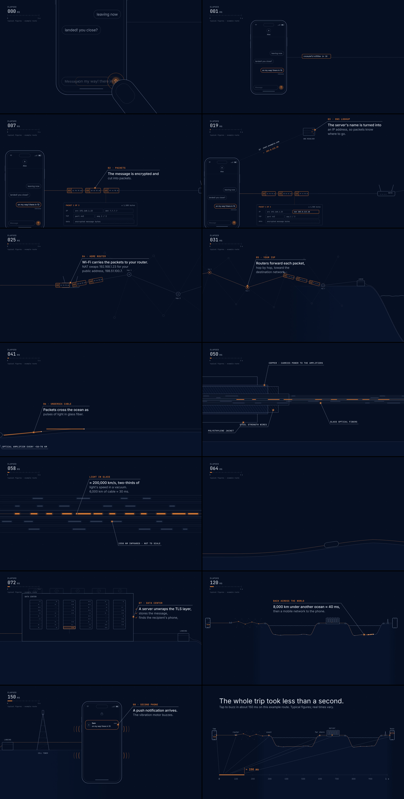

# one second

**What happens in the 1 second after you hit send.** A 40-second, 1080p60 motion-design film made entirely with code: no images, no audio files, no video editor.

▶ [`output/send.mp4`](output/send.mp4) · 1920×1080 · 60 fps · 40 s · H.264 + AAC · −14 LUFS



## The trip, in order

The whole film is one continuous camera move through a single 2D world laid out in the order the message travels. There are no cuts.

| # | Stage | What's shown |
|---|-------|--------------|
| 01 | Touch | Thumb taps send; the capacitive screen registers it |
| 02 | Packets | Text scrambles into ciphertext and is cut into packets; one packet's header is opened up (src, dst, port 443, seq) |
| 03 | DNS | `A? chat.example.com` → `203.0.113.10` fills in the packet's empty destination field |
| 04 | Home router | Wi-Fi to the router; NAT rewrites `192.168.1.23` → `198.51.100.7` |
| 05 | ISP | Hop-by-hop forwarding through the provider's mesh to a cable landing station |
| 06 | Undersea cable | Down the continental slope to the seabed; the camera dives into a cable cutaway (jacket, copper, steel, fibers) and then into one glass core with light pulses |
| 07 | Data center | Racks; one server unwraps TLS, stores the message, finds the recipient, hands off to Apple/Google push |
| 08 | Second phone | Back across another ocean and a mobile network; a notification lands and the phone buzzes |
| — | End card | The route stays on screen and fans down onto a 0–1 s time axis; the trip ends at ≈150 ms |

## Facts and sources

The film calls its timings "typical figures · example route" on screen. Every number shown:

- **Light in fiber ≈ 200,000 km/s, about ⅔ of *c*.** Silica's refractive index is ≈1.47, so 299,792 / 1.47 ≈ 204,000 km/s.
- **6,000 km ≈ 30 ms, 8,000 km ≈ 40 ms.** Distance divided by the speed above (one way).
- **1550 nm infrared.** The standard long-haul wavelength band (C-band).
- **Optical amplifiers every ~50–70 km.** Typical submarine repeater spacing, e.g. a 10,000 km trans-Pacific system has about 150–180 repeaters ([arXiv:1806.01945](https://arxiv.org/pdf/1806.01945), [US9893834](https://image-ppubs.uspto.gov/dirsearch-public/print/downloadPdf/9893834)).
- **Copper layer powers the amplifiers.** Repeaters are fed DC from shore through the cable's copper conductor. Polyethylene insulation and steel strength wires are standard deep-sea construction.
- **≤ 1,500 bytes per packet.** The Ethernet/Wi-Fi IP MTU.
- **`chat.example.com`, `203.0.113.10`, `198.51.100.7`.** Reserved documentation names and addresses (RFC 2606, RFC 5737), so no real host is implied. `192.168.1.23` is a private RFC 1918 address, as used behind home NAT.
- **Push via APNs / FCM.** How messaging servers wake iOS and Android phones.
- **Timeline (cumulative):** DNS ~20 ms (if not cached) · Wi-Fi + router ~3 ms · ISP ~10 ms · ocean 30 ms · server ~10 ms · return ocean 40 ms + mobile network/push ~30 ms · ≈150 ms tap to buzz. Real times vary with route, network and caching. The claim that matters, "less than a second", holds with a wide margin.

The drawings are diagrams, not to scale (the fiber close-up says so on screen).

## How it's built

- `src/world.ts`: world geometry (terrain, route, stations), the camera keyframes, the packet motion and the clock. Camera and packets use monotone cubic interpolation, so motion is smooth with no overshoot.
- `src/film.ts`: `draw(ctx, t)`, a pure function of time on Canvas 2D. Lines keep a constant on-screen width at any zoom (the camera goes from 0.12× to 150×); labels are drawn in screen space so they stay crisp and readable.
- `src/audio.ts`: the soundtrack, synthesized in an `OfflineAudioContext` from oscillators and seeded noise: ticks on taps and hops, filtered-noise whooshes for light in glass, a 60 Hz-harmonic data-center hum, a 170 Hz motor buzz.
- `scripts/render.mjs`: headless Chromium (Playwright) renders frame *n* = `draw(t = n/60)` → PNG → ffmpeg/x264, on 4 parallel workers. Audio goes through two-pass EBU R128 `loudnorm` plus a measured trim to exactly −14 LUFS (true peak ≤ −1.5 dBTP), then is muxed.
- `scripts/frames.mjs`: renders stills at given timestamps for review.

Frames are deterministic: the same timestamp produces bit-identical PNGs on every run.

```sh
pnpm install
pnpm dev                 # interactive preview with scrubber + sound
pnpm render              # → output/send.mp4  (CRF=… WORKERS=… to tune)
pnpm frames 10.9 22.7    # stills → output/frames/
```

Requires Node 20+, pnpm, ffmpeg, and a Chromium that Playwright can find.
