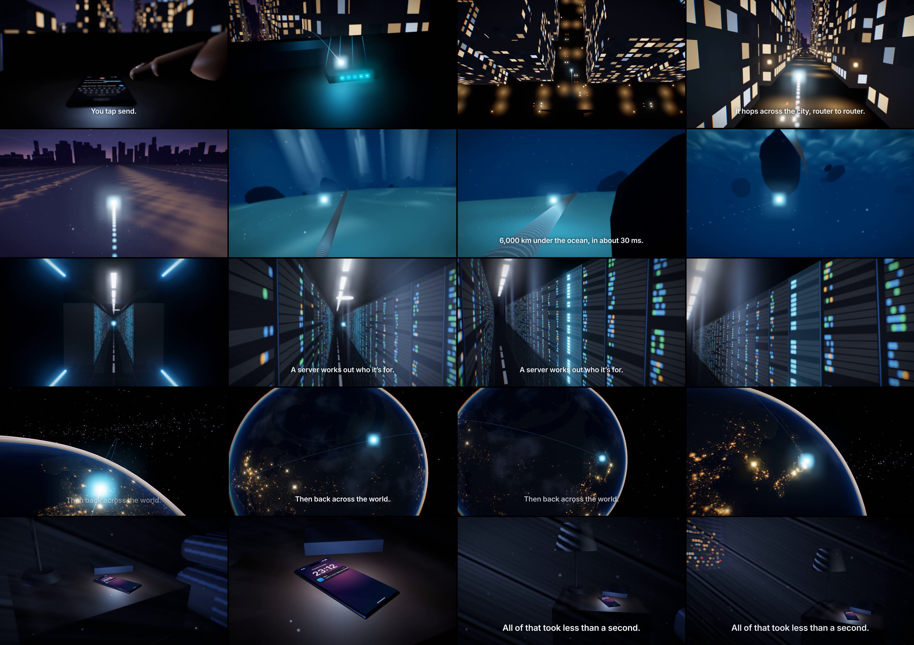

# one second

**What happens in the 1 second after you hit send.** A 34-second, 1080p60 film made entirely with code in three.js: one particle of light, one continuous camera move, no image files, no audio files.

▶ [`output/send.mp4`](output/send.mp4) · 1920×1080 · 60 fps · 34 s · H.264 + AAC · −14 LUFS



## The trip

We follow the message as a single glowing particle from the sender's thumb to the receiver's nightstand.

| Time | Scene | On screen |
|---|---|---|
| 0–4.5 s | A dark room. A thumb taps send on a glowing phone; the message bursts into light, passes through the Wi-Fi router and out of the window. | *You tap send.* |
| 4.5–10.5 s | Over the city at night: an aerial reveal of the glowing street grid, then a race down the streets, turning at junctions. | *It hops across the city, router to router.* |
| 10.5–17.6 s | Into the harbour and down to the sea floor: light shafts, drifting particles, and the light riding an armoured undersea cable into a landing tunnel. | *6,000 km under the ocean, in about 30 ms.* |
| 17.6–23 s | A data-center hall: endless rows of blinking racks over a polished floor. The light dives into one rack, which lights up as the server handles the message. | *A server works out who it's for.* |
| 23–28.6 s | Earth at night from orbit: the light arcs from Frankfurt to Tokyo over real city lights. | *Then back across the world.* |
| 28.6–34 s | A bedroom in moonlight. The light slips through the blinds into a phone on the nightstand, which wakes and buzzes. | *All of that took less than a second.* |

Scenes are joined by camera moves: out of a window, under the water surface, through a tunnel, through a burst of light. There are no cuts.

## Facts

- **6,000 km in about 30 ms.** Light in optical fiber travels at about 200,000 km/s (glass has a refractive index of about 1.47, so 299,792 / 1.47 ≈ 204,000 km/s). 6,000 km ÷ 200,000 km/s = 30 ms. A transatlantic cable is roughly this length.
- **Router to router.** Packets leave home through the Wi-Fi router, then are forwarded hop by hop through the provider's routers.
- **Under the ocean.** Intercontinental traffic runs through armoured fiber-optic cables on the sea floor that come ashore at landing stations.
- **A server works out who it's for.** The messaging service's server identifies the recipient's device and hands the message to the push service that wakes it.
- **Less than a second.** End to end, a message like this typically arrives in a fraction of a second, well under one.
- **Earth at night** is painted from data: 36,830 places with population ≥ 8,000 from [GeoNames](https://www.geonames.org/) (via `all-the-cities`), and coastlines from [Natural Earth](https://www.naturalearthdata.com/) (via `world-atlas`). Brighter, bigger glows mean larger populations. Clouds, airglow and atmosphere are procedural.

## How it's built

- **three.js on Canvas/WebGL**, TypeScript, Vite, pnpm. Every frame is a pure function of time `t`: particle trails are sampled from the path's own past, LEDs blink from hashes of `floor(t · rate)`, and drifting particles move by formula. There is no simulation state, so any frame renders identically on its own.
- `src/sets/home.ts`: room, city, harbour and ocean in one world, so the camera can fly continuously from the desk through the window, over the streets and under the water. Buildings use a procedural window shader; the sea floor has rippled sand, caustics and boulders; the cable glows only where the light is.
- `src/sets/datacenter.ts`: about 800 instanced racks with per-unit blinking LEDs, mirrored for the polished floor, plus haze and ceiling light strips.
- `src/sets/space.ts`: the night-lights texture (8192×4096) is painted at startup from the city and coastline data. The Earth shader adds clouds, a dawn sliver at the limb, atmosphere and green airglow shells, and stars.
- `src/sets/bedroom.ts`: shadow-mapped moonlight through blind slats, a volumetric shaft, dust, and the city outside the window.
- `src/post.ts`: a custom pipeline. The scene is rendered once to HDR with depth, then depth of field (a 28-tap golden-angle gather), bloom, and a grade (ACES, split-tone, vignette, chromatic aberration, deterministic grain).
- `src/audio.ts`: the soundtrack, synthesized offline in Web Audio. It has a tap tick, deep filtered-noise whooshes with sub-bass sweeps, a city rumble, a splash and ocean rumble, data-center mains hum and fans, a space drone, a phone buzz with nightstand rattle, and a closing chord.
- `scripts/render.mjs`: Playwright drives headless Chromium with WebGL on SwiftShader (CPU), so pixels don't depend on a GPU. Each frame is captured as a JPEG at quality 0.96 and piped to ffmpeg as a near-lossless intermediate. A two-pass x264 encode then targets a size budget (under 95 MB). Audio goes through two-pass EBU R128 `loudnorm` plus a measured trim to exactly −14 LUFS.

```sh
pnpm install
pnpm dev                     # scrub any frame in the browser
pnpm render                  # → output/send.mp4 (about an hour on 4 CPU cores)
pnpm frames 0.8 13 25        # stills → output/frames/
node scripts/build-geo.mjs   # regenerate src/data/cities.json
```

Requires Node 20+, pnpm, ffmpeg, and a Chromium that Playwright can find.
